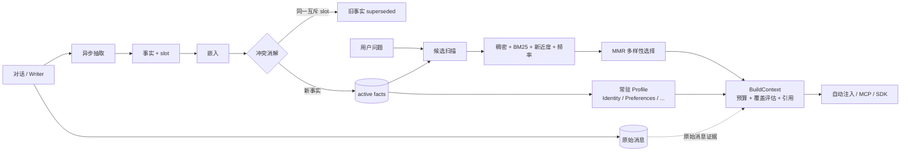

<p align="center">
  
</p>

<h1 align="center">Memorigo</h1>

<p align="center">
  <strong>Agent 的生产级长期记忆，一个 Go 单二进制。</strong><br>
  写入、抽取、时态、混合召回、常驻画像、预算上下文，一次接上 MCP、REST 和 OpenTelemetry。
</p>

<p align="center">
  <a href="https://github.com/Deep-Octopus/Memorigo/actions"></a>
  
  
  
  
</p>

<p align="center">
  <a href="#快速开始">快速开始</a> ·
  <a href="#上下文引擎-v2">上下文引擎</a> ·
  <a href="#mcp-server">MCP Server</a> ·
  <a href="#评测与性能">评测与性能</a> ·
  <a href="docs/ARCHITECTURE.md">架构</a> ·
  <a href="docs/ROADMAP.md">路线图</a>
</p>

---

## 为什么是 Memorigo

Agent 记忆不该是一个向量库套壳，也不该把对话交到别人的云上。Memorigo 把整条链路收进一个可自托管的 Go 库：数据留在你的 SQLite、PostgreSQL 或 MongoDB，离线就能跑，上线时带多租户、鉴权、审计和追踪。

- **整条记忆链路都在库里**：事实抽取、slot 时态覆盖、四路混合排序、MMR、常驻画像、token 预算、引用回链、自适应检索。
- **数据不出域**：hash 嵌入和启发式抽取完全离线；要语义时再接 OpenAI、硅基流动或本机 Ollama。
- **按生产系统交付**：16 个回归场景全绿，MCP、REST、Docker、跨平台 release 和 race 测试都已接通。PostgreSQL 上还有 pgvector HNSW、行级安全和 OAuth。

> Memorigo 的定位是 **BYODB + 数据不出域 + 单二进制分发**。与 Python 版 [Memori](https://github.com/MemoriLabs/Memori) 的架构思路对齐，但存储、检索、上下文与分发层用 Go 重新实现。

### 能力对比

| 能力 | Memorigo | 典型向量库封装 | 典型托管记忆 API |
|---|---|---|---|
| 数据驻留 | 你的数据库/文件 | 你的数据库 | 厂商云 |
| 事实抽取 + slot 覆盖 | 内置 | 需自建 | 有 |
| 稠密 + BM25 + 新近度 + 频率 | 内置 | 通常仅向量 | 部分 |
| 常驻用户画像（查询无关） | 内置 | 需自建 | 部分 |
| MMR 多样性 + 覆盖率弃权 | 内置 | 需自建 | 少见 |
| Token 预算 + 引用上下文 | 内置 | 需自建 | 部分 |
| 事实 + 原始证据 + 常驻画像 | 内置 | 需自建 | 少见 |
| MCP stdio + HTTP | 内置 | 通常无 | 部分 |
| 完全离线运行 | hash + heuristic | 取决于实现 | 否 |
| 自适应检索 | 内置 | 需自建 | 少见 |
| PostgreSQL pgvector HNSW | 内置 | 需自建 | 部分 |
| 多租户 + 行级安全 | 内置 | 需自建 | 部分 |
| MCP OAuth + Bearer | 内置 | 通常无 | 部分 |
| OpenTelemetry | 内置 | 需自建 | 部分 |
| 主体导出 / 删除 / PII 遮盖 | 内置 | 取决于实现 | 部分 |
| 可审计软删除 + 来源追踪 | 内置 | 取决于实现 | 部分 |

---

## 架构



完整设计见 [docs/ARCHITECTURE.md](docs/ARCHITECTURE.md)。几个关键决策：

- **写路径幂等**：同一 session 内客户端重发完整历史不会重复落库或膨胀 `num_times`。
- **只落库原始消息**：注入的记忆块不会污染后续对话历史。
- **三通道上下文**：常驻画像保证稳定背景，查询事实提供高信号压缩视图，原始消息在抽取遗漏时兜底。
- **先选多样性，再排位置**：MMR 避免预算被近重复事实占满；强证据放在上下文首尾，降低 lost-in-the-middle。
- **默认纯 Go**：`CGO_ENABLED=0` 可构建；SQLite 使用 `modernc.org/sqlite`。

---

## 快速开始

要求 **Go 1.25+**（官方 MCP Go SDK 的最低版本）。

```bash
go get github.com/Deep-Octopus/Memorigo
```

```go
package main

import (
	"context"
	"database/sql"
	"fmt"
	"time"

	"github.com/Deep-Octopus/Memorigo/memori"
	_ "modernc.org/sqlite"
)

func main() {
	db, err := sql.Open("sqlite", "file:memorigo.db?_pragma=busy_timeout(5000)&_pragma=journal_mode(WAL)")
	if err != nil {
		panic(err)
	}
	defer db.Close()

	// 自动建表 / 迁移；不需要手动 Build。
	m := memori.New(memori.WithStorageConn(db))
	defer m.Close()

	if err := m.TryAttribution("user-42", "support-agent"); err != nil {
		panic(err)
	}

	ctx, cancel := context.WithTimeout(context.Background(), 10*time.Second)
	defer cancel()

	// 写入一轮对话。只写新增消息；客户端重发历史不会重复落库。
	err = memori.NewWriter(m).Execute(ctx, memori.ConversationPayload{
		Messages: []memori.Message{
			{Role: "user", Content: "My favorite color is blue"},
			{Role: "user", Content: "I live in Shanghai"},
		},
		Response: &memori.Message{Role: "assistant", Content: "Noted."},
	})
	if err != nil {
		panic(err)
	}

	// 等待后台抽取 / 嵌入 / 冲突消解完成。
	if err := m.Flush(ctx); err != nil {
		panic(err)
	}

	// 检索事实。
	facts, err := m.Recall("favorite color", 5)
	if err != nil {
		panic(err)
	}
	for _, f := range facts {
		fmt.Printf("%.3f  %s  [%s]\n", f.Score, f.Content, f.Slot)
	}

	// 组装带引用、受 token 预算约束的上下文。
	pkg, err := m.BuildContext(ctx, "What does the user prefer?", memori.ContextOptions{
		TokenBudget: 600,
		IncludeRaw:  true,
	})
	if err != nil {
		panic(err)
	}
	fmt.Println(pkg.Text)
}
```

运行仓库内示例：

```bash
go run ./examples/sqlite
go run ./examples/adapter      # 不依赖其他框架，注入的 system 消息不会写回记忆
go run ./examples/postgres     # 需要 POSTGRES_DSN
go run ./examples/mongodb      # 需要 MONGODB_URI
```

---

## 上下文引擎 v2

`BuildContext` 把三条通道放进同一个 token 预算：**常驻 Profile**（查询无关的稳定背景）、**查询事实**（混合召回 + MMR 多样性选择）、**原始对话证据**（抽取遗漏时的兜底）。返回前还会计算覆盖率、标记证据不足，并把强证据放到上下文首尾。

```go
pkg, err := m.BuildContext(ctx, "What does the user prefer?", memori.ContextOptions{
	TokenBudget:           600,  // 0 使用 MEMORI_CONTEXT_BUDGET（默认 800）
	IncludeProfile:        true, // 注入常驻画像
	IncludeDynamicProfile: false, // 默认只放稳定事实，不放近期焦点/情绪
	IncludeRaw:            true, // 加入相关原始消息
	RawLimit:              4,    // 最多 4 条
	RawScan:               200,  // 扫描最近 200 条消息
	MMRLambda:             0.7,  // 相关性 vs 多样性；0.7 是默认值
	RawBudgetShare:        0.25, // 为原始证据预留剩余预算的 25%
	MinCoverage:           0.5,  // 查询词覆盖率低于 50% 时标记证据不足
})
```

| 字段 | 含义 |
|---|---|
| `Text` | 以 `<memory_context>` 包裹的 prompt-ready 文本 |
| `Profile` / `ProfileText` / `ProfileCount` | 常驻画像的结构化事实、渲染文本与条数 |
| `Facts` / `Messages` | 结构化结果；消息可跨 session 检索同一 entity |
| `Citations` | `fact:<id>` / `msg:<id>`，包含 Profile 事实，可回链到原始来源 |
| `Tokens` / `Budget` / `Truncated` | 估算用量、生效预算、是否裁剪 |
| `Coverage` / `TopScore` | 查询词元覆盖率与最高事实分 |
| `InsufficientEvidence` | 无证据或覆盖率低于 `MinCoverage` 时为 true |
| `FactCount` / `RawCount` | 两条查询通道各自命中的条数 |

自动注入复用同一引擎，默认同时注入 Profile 与查询事实，整体预算仍由 `MEMORI_CONTEXT_BUDGET` 控制。完整算法见 [docs/ARCHITECTURE.md](docs/ARCHITECTURE.md#75-上下文组装)。

### 常驻画像 Profile

画像不依赖当前 query，适合每轮都注入的“用户背景”。它直接从活跃事实的 slot 归类，无需额外 schema 或 LLM：

```text
<memory_profile>
Identity:
- [fact:12] My name is Alice
- [fact:18] I live in Shanghai
Preferences:
- [fact:21] My favorite color is blue
Skills:
- [fact:28] I use Go every day
</memory_profile>
```

```go
profile, _ := m.Profile(ctx, memori.ProfileOptions{
	TokenBudget:    200,
	MaxFacts:       40,
	IncludeDynamic: false, // 近期焦点/情绪默认不进入画像
})
fmt.Println(profile.Text)
```

- 静态分组：Identity、Preferences、Health、Skills。
- 动态分组：Current focus、Opinions、Recent context；`IncludeDynamic` 打开，且只保留 90 天内有更新的事实。
- 画像预算默认 200 token / 40 条，且在 `BuildContext` 中最多占整体预算的 1/3，不会挤掉查询证据。
- Profile 与查询事实按 id 和内容双重去重；同一条记忆不会在上下文里出现两次。

### 混合召回 + MMR

召回不是单一余弦相似度。候选集内按归一化权重融合四路信号：

```text
score = 0.60 * cosine_similarity
      + 0.20 * bm25_lexical
      + 0.10 * exp(-ln2 * age / half_life)
      + 0.10 * log1p(num_times) / log1p(max_num_times)
```

- 词法通道同时支持英文单词与中日韩字符 bigram。
- 有相关度闸门：查询有词元时，必须命中词法或达到最低余弦相似度。
- 权重、半衰期、扫描上限、最低分均可配置。
- 返回 `Score`、`Similarity`、`LexicalScore`、`NumTimes`、`Slot`，便于调试。

取事实时先放宽候选池（`FactLimit × 4`，上限 200），再用 **MMR** 选择：

```text
pick = argmax(lambda * relevance - (1 - lambda) * max_similarity_to_selected)
```

默认 `lambda=0.7`；`DisableDiversity=true` 可回到纯 top-k。这样在小预算下不会连续塞入“同义反复”的事实。

### 覆盖率与弃权

`Coverage` 是查询词元被最终证据覆盖的比例（事实 + 消息 + Profile）。`MinCoverage > 0` 时，低于阈值会把 `InsufficientEvidence` 置为 true，调用方可以让模型回答“不知道”，而不是基于无关记忆硬编。没有显式阈值时，只有完全找不到任何证据才会标记。

### Lost-in-the-middle 重排

渲染顺序不是简单按分数排列：最强事实放第一，第二强放最后，其余向中间填。结构化 `Facts` 仍按分数排序，便于程序消费；只有 prompt 文本做位置优化。`DisableMiddleOrder=true` 可关闭。

### 时态事实

每条事实可带 `slot` 与 `status`。互斥 slot（`profile.*`、`favorite.*`、`sentiment.*`、`health.allergy.*`）写入新值时，旧事实变为 `superseded`，不再参与召回，但保留审计记录。`Forget(id)` 执行软删除。`Maintain` 把长时间未被提及、且提及次数低于 `ProtectTimes` 的 active 事实标为 `expired`；`TTL <= 0` 时什么都不做。`Restore(id)` 只重新打开 `expired` 行，不会打开被覆盖或被 `Forget` 的行。自动抽取不会复活 `superseded` / `deleted` / `expired`；显式 `Remember` 同一内容会重新激活。

---

## MCP Server

Memorigo 可以直接作为 MCP server 接入 Claude Desktop、Claude Code、Cursor 等客户端。

```bash
# 方式一：从源码构建
CGO_ENABLED=0 go build -o bin/memorigo-mcp ./cmd/memorigo-mcp
./bin/memorigo-mcp -version

# 方式二：安装到 GOPATH/bin
go install github.com/Deep-Octopus/Memorigo/cmd/memorigo-mcp@latest
```

### stdio：本地 Agent

```json
{
  "mcpServers": {
    "memorigo": {
      "command": "/absolute/path/to/bin/memorigo-mcp",
      "args": ["-db", "/Users/you/.memorigo/memory.db"]
    }
  }
}
```

### HTTP：远程 Agent / 容器

```bash
export MEMORI_MCP_TOKEN="$(openssl rand -hex 32)"
./bin/memorigo-mcp -http -addr 127.0.0.1:8787 -db /var/lib/memorigo/memory.db
```

- MCP endpoint：`http://127.0.0.1:8787/mcp`
- 健康检查：`http://127.0.0.1:8787/healthz`
- 默认要求 `Authorization: Bearer <token>`；匿名模式必须显式 `-allow-anonymous`。
- 支持直接 TLS（`-tls-cert` / `-tls-key`），也支持在反向代理后终止 TLS。

### Docker

```bash
docker build -t memorigo-mcp .
docker run --rm -p 8787:8787 \
  -e MEMORI_MCP_TOKEN="$(openssl rand -hex 32)" \
  -v memorigo-data:/data \
  memorigo-mcp
```

### 工具面

| 工具 | 作用 |
|---|---|
| `memory_search` | 混合召回，返回事实、分数与 slot |
| `memory_context` | 组装三通道上下文；默认带 Profile，支持 MMR、覆盖率弃权与位置重排 |
| `memory_remember` | 显式写入事实；互斥 slot 自动覆盖旧值 |
| `memory_rule` | 写入常驻规则，进入画像，随每一轮上下文下发 |
| `memory_forget` | 按 id 软删除 |
| `memory_profile` | 返回分组画像（Identity / Preferences / Health / Skills / ...）及渲染文本 |
| `memory_stats` | 事实数、积压任务、嵌入模型/维度、存储方言 |

每个工具都支持可选的 `entity_id`，用于按用户隔离。详细配置、安全边界和排错见 [docs/MCP.md](docs/MCP.md)。

---

## 评测与性能

### 确定性回归

```bash
go run ./cmd/memorigo-eval
go run ./cmd/memorigo-eval -json
make eval
```

16 个场景一次跑完：偏好召回、覆盖更新、搬家、跨 session、遗忘、噪声抵抗、中文召回、租户隔离、token 预算、原始证据、常驻画像、动态画像、覆盖率弃权和短窗口挤出。内存 SQLite + 离线 hash 嵌入，不需要 API key。同一条命令给出 full-context 与 naive RAG 的对照。LongMemEval oracle 用 `sh eval/datasets/download.sh` 拉下来即可接入，也可以打开 `MEMORI_EVAL_JUDGE` 做 LLM 评分。

```text
accuracy: 16/16 (100.0%)  avg latency: 299µs  p95: 470µs  avg tokens: 27
baselines (want-string hit rate, hash embedder, no LLM judge): full-context 12/13, naive-rag 13/13
```

（示例输出；延迟随机器与负载波动。）

工程验证：

```bash
make test      # 单元 + 集成
make race      # race detector
make check     # gofmt + vet + build + test + eval
```

### 微基准

```bash
make bench
# 或显式指定：
go test ./memori -run '^$' -bench 'Benchmark(Recall|BuildContext)1000' -benchmem
```

1,000 条事实，Apple M5，Go 1.26.3：

| Benchmark | Time / op | Allocated / op | Allocs / op |
|---|---:|---:|---:|
| `Recall` (top-5) | ~11 ms | ~5.5 MB | ~40k |
| `BuildContext` (800-token) | ~11 ms | ~5.5 MB | ~40k |

1,000 条事实上，纯 Go 路径一次召回大约 11 ms。词法走 FTS5 / GIN，融合可以切到 RRF，第二阶段可以接 HTTP rerank。PostgreSQL 打开 pgvector 后，稠密候选走 HNSW。默认构建保持 `CGO_ENABLED=0` 的单二进制。方法见 [docs/EVALUATION.md](docs/EVALUATION.md)。

---

## 存储与部署

| 后端 | 接入 | 事务 | 适用场景 |
|---|---|---|---|
| SQLite | `*sql.DB`（modernc.org/sqlite） | 真实事务 | 单进程、本地 Agent、边缘部署 |
| PostgreSQL | `*sql.DB`（pgx stdlib） | 真实事务 + 串行化失败重试 | 多进程、生产推荐 |
| MongoDB | `*mongo.Database` | 文档模型 | 已有 Mongo 基础设施 |

迁移在 `New()` 时自动执行，也可以显式调用 `m.Storage.Build()`（幂等）。schema 包含 entity / process / session / conversation / message / fact，以及可选的 subject-predicate-object 知识图基础表。

生产检查清单：

- SQLite 开启 WAL 与 `busy_timeout`，并确保只有一个写入进程；多进程请使用 PostgreSQL。
- 为每个终端用户使用独立 `entity_id`，不要把 MCP 默认 entity 共享给多租户。
- 固定嵌入模型与维度；更换后调用 `Reindex(ctx)`。
- 备份数据库文件/实例；SQLite 使用 WAL 时请包含 `-wal` / `-shm`，或先 checkpoint；软删除不等于物理删除。
- MCP HTTP 使用长随机 token、TLS 或可信反向代理；只读客户端使用 `-readonly`。
- 监控 `Stats(ctx)`、队列积压、嵌入错误与 `/healthz`。

---

## 配置

所有配置可由环境变量提供，也可以在 `New(WithConfig(...))` 中覆盖。常用项：

### 核心

| 环境变量 | 默认值 | 说明 |
|---|---|---|
| `MEMORI_RECALL_LIMIT` | `5` | 默认召回条数 |
| `MEMORI_CONTEXT_BUDGET` | `800` | `BuildContext` / 自动注入的 token 预算 |
| `MEMORI_AUTO_INJECT` | `true` | 是否自动注入记忆 |
| `MEMORI_INJECT_LIMIT` | `5` | 单次注入事实条数 |
| `MEMORI_MEMORY_PROMPT` | 内置模板 | 必须含 `{{facts}}` |
| `MEMORI_OP_TIMEOUT` | `20s` | 单次召回/操作超时 |
| `MEMORI_LOG_LEVEL` | `error` | `debug/info/warn/error/off` |

### 常驻画像

| 环境变量 | 默认值 | 说明 |
|---|---|---|
| `MEMORI_PROFILE_BUDGET` | `200` | Profile 渲染 token 上限 |
| `MEMORI_PROFILE_LIMIT` | `40` | Profile 最多事实条数 |
| `MEMORI_PROFILE_DYNAMIC` | `false` | 是否把近期焦点/情绪纳入 Profile |

### 嵌入与抽取

| 环境变量 | 默认值 | 说明 |
|---|---|---|
| `MEMORI_EMBEDDING_PROVIDER` | `hash` | `hash` / `openai` / `siliconflow` / `ollama` |
| `MEMORI_EMBEDDING_API_KEY` | — | 远程嵌入密钥。Ollama 默认为空 |
| `MEMORI_EMBEDDING_BASE_URL` | 提供商默认 | Ollama 默认 `http://127.0.0.1:11434` |
| `MEMORI_EMBEDDING_MODEL` | 提供商默认 | 如 `text-embedding-3-small`、`BAAI/bge-m3`、`nomic-embed-text` |
| `MEMORI_EMBEDDING_DIMENSION` | `0`（提供商默认） | 自定义维度 |
| `MEMORI_EXTRACTION_PROVIDER` | `heuristic` | `heuristic` / `llm` / `off` |
| `MEMORI_EXTRACTION_MODEL` | 最近一次聊天模型 | LLM 抽取模型 |
| `MEMORI_EXTRACTION_MAX_FACTS` | `20` | 单轮最多事实数 |
| `MEMORI_EXTRACTION_MERGE_THRESHOLD` | `0.97` | 无语义槽位事实的近重复阈值 |
| `MEMORI_PII_REDACT` | `false` | 写入前遮盖邮箱、电话和通过 Luhn 的卡号 |
| `MEMORI_RLS` | `off` | `on` 时 PostgreSQL 对实体、会话、消息、事实和知识图谱边启用 `FORCE ROW LEVEL SECURITY` |
| `MEMORI_OTEL_ENDPOINT` | 空 | OTLP/HTTP 收集端。设置后，召回、写入和上下文组装自动导出 span |
| `MEMORI_OTEL_SERVICE_NAME` | `memorigo` | span 资源上的 `service.name` |

### 召回

| 环境变量 | 默认值 | 说明 |
|---|---|---|
| `MEMORI_RECALL_SCAN_LIMIT` | `2000` | 候选事实扫描上限 |
| `MEMORI_RECALL_MIN_SCORE` | `0.05` | 最低融合分 |
| `MEMORI_RECALL_MIN_SIMILARITY` | `0.10` | 最低余弦相似度闸门 |
| `MEMORI_RECALL_WEIGHT_*` | `0.60/0.20/0.10/0.10` | 相似度/词法/新近度/频率权重 |
| `MEMORI_RECALL_RECENCY_HALF_LIFE` | `168h` | 新近度半衰期 |
| `MEMORI_RECALL_ADAPTIVE` | `true` | 问候、空查询或上下文已经覆盖时跳过召回，并先改写查询 |
| `MEMORI_RECALL_ADAPTIVE_COVERAGE` | `0.85` | 已有文本覆盖查询词元达到该比例才跳过。只在调用方提供已有文本时生效 |
| `MEMORI_RERANK` | `off` | `http` 时把前列候选送去交叉重排 |
| `MEMORI_RERANK_URL` | — | 完整 rerank 端点，如 `https://api.jina.ai/v1/rerank` |
| `MEMORI_RERANK_MODEL` | — | 如 `BAAI/bge-reranker-v2-m3` |
| `MEMORI_RERANK_TOP_N` | HTTP 时 `20`，否则 `0` | 送去重排的候选数。`0` 关闭 |
| `MEMORI_PGVECTOR` | `auto` | PostgreSQL 上用 pgvector HNSW 补充稠密候选。`auto` 检测到扩展就启用 |

完整列表见 [docs/ARCHITECTURE.md](docs/ARCHITECTURE.md) 与源码 `memori/config.go`。

---

## API 速查

```go
// 身份与生命周期
m := memori.New(memori.WithStorageConn(db))
m.TryAttribution("user-42", "agent-7")
m.NewSession()
m.Flush(ctx)
m.Close()                 // 不关闭用户传入的 db

// 写入
memori.NewWriter(m).Execute(ctx, memori.ConversationPayload{...})
m.Remember("I prefer window seats")   // 同步；返回 fact id
m.Forget(factID)
report, _ := m.Maintain(memori.MaintainOptions{TTL: 90 * 24 * time.Hour, ProtectTimes: 2})
_ = report
m.Restore(factID) // 只重新打开 status=expired
exported, _ := m.Export(memori.ExportOptions{Redact: true})
_ = exported
report, _ := m.DeleteSubject() // 硬删除当前主体；再次调用是空操作
_ = report

// 读取
facts, _ := m.Recall("seat preference", 5)
mc, _ := m.MemoryContext(ctx, "seat preference", 5)
text, _ := m.ContextText(ctx, "seat preference", 5)
pkg, _ := m.BuildContext(ctx, "seat preference", memori.ContextOptions{
    TokenBudget: 600, IncludeProfile: true, IncludeRaw: true,
})
facts, _ := m.Facts(20)
profile, _ := m.Profile(ctx, memori.ProfileOptions{TokenBudget: 200})
stats, _ := m.Stats(ctx)

// 维护
n, _ := m.Reindex(ctx)    // 嵌入模型/维度变化后重建
```

---

## JSON API

`cmd/memorigo-api` 把同一套记忆暴露成 HTTP。除 `/healthz` 外都要 `Authorization: Bearer <token>`，除非显式 `-allow-anonymous`。

```bash
CGO_ENABLED=0 go build -o bin/memorigo-api ./cmd/memorigo-api
./bin/memorigo-api -db memorigo.db -token "$MEMORI_API_TOKEN"
curl -s -H "Authorization: Bearer $MEMORI_API_TOKEN" \
  -H "Content-Type: application/json" \
  -d '{"content":"I like jazz records","entity_id":"alice"}' \
  http://127.0.0.1:8788/v1/remember
```

写入：`/v1/remember`、`/v1/rules`、`/v1/forget`、`/v1/restore`、`/v1/maintain`、`DELETE /v1/subject`。读取：`/v1/recall`、`/v1/context`、`/v1/facts`、`/v1/profile`、`/v1/stats`、`/v1/export`。`-readonly` 把实例锁成只读。`/v1/rules` 把常驻规则送进画像。

---

## 项目结构

```text
memori/       Memori 门面、Writer、增强流水线、召回排序、MMR、Profile、上下文组装、抽取器、OpenAI 兼容层
storage/      Repos 抽象、SQL/Mongo 实现、迁移、事务
embed/        嵌入接口、hash/OpenAI/硅基流动/Ollama、可选 HTTP rerank、LRU、HTTP 重试
textutil/     归一化、分词（英文 + CJK bigram）、句子切分、token 估算
mcpserver/    MCP 工具面 + stdio/HTTP 适配
eval/         确定性评测场景、报告、JSON 输出
cmd/          memorigo-eval、memorigo-mcp、memorigo-api
api/          JSON HTTP API（Bearer，/v1/recall 等）
adapter/      框架无关的上下文注入（不依赖 Eino / Genkit）
internal/     版本与构建元数据
Dockerfile    多阶段 MCP 镜像（非 root + healthcheck）
examples/     SQLite / PostgreSQL / MongoDB / OpenAI / SiliconFlow / Embedding / adapter
docs/         架构、MCP、评测、路线图
```

---

## 平台能力

一条记忆链路，从嵌入式 Agent 到多租户服务：

- **记忆引擎**：幂等写入、时态 slot、四路混合排序、MMR、常驻画像、token 预算、引用、自适应检索
- **检索**：稠密 + BM25 + 新近度 + 频率，可选 RRF、HTTP rerank、PostgreSQL pgvector HNSW
- **多租户**：`org` / `app` 作用域，PostgreSQL `FORCE ROW LEVEL SECURITY`
- **接入**：MCP stdio 与 Streamable HTTP、Bearer 与 OAuth、JSON API、框架无关 adapter
- **治理**：工具授权、配额、JSONL 审计、OpenTelemetry、主体导出与删除、PII 遮盖
- **交付**：纯 Go 单二进制、Docker、16 个场景全绿、CI 与 race 检测

演进记录见 [docs/ROADMAP.md](docs/ROADMAP.md)。

---

## 贡献与安全

- 开发、测试与 PR 规范：[CONTRIBUTING.md](CONTRIBUTING.md)
- 漏洞报告与部署安全：[SECURITY.md](SECURITY.md)
- 版本记录：[CHANGELOG.md](CHANGELOG.md)

## License

MIT. 见 [LICENSE](LICENSE)。
