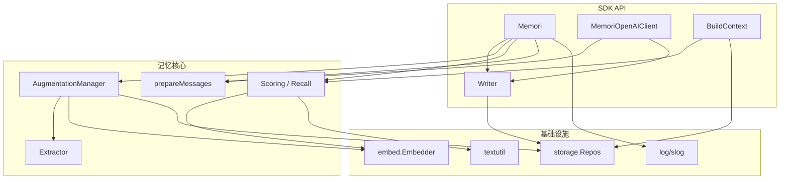
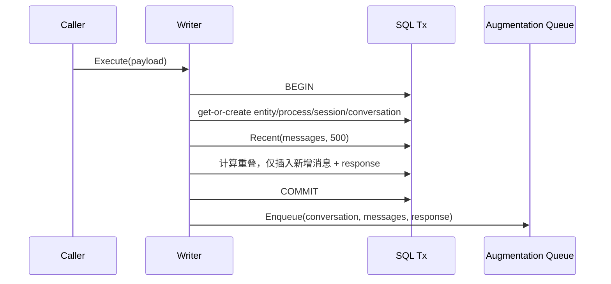

# Memorigo 架构设计

本文描述当前实现（2026-11）的内部结构与关键决策。目标是让贡献者能在不读完全部源码的情况下理解：一条消息如何变成一条可召回的记忆，以及为什么这样分层。

---

## 1. 目标与非目标

### 目标

1. **闭环正确**：任何进入 Writer 的对话都能被持久化、抽取、嵌入、冲突消解，并在下一轮被召回。
2. **存储无关**：同一套 `Repos` 语义覆盖 SQLite / PostgreSQL / MongoDB；SQL 走真实事务。
3. **LLM 无关**：Chat Completions 兼容层覆盖 OpenAI、硅基流动以及任何兼容网关；无 LLM 也能用 hash 嵌入 + 启发式抽取跑通。
4. **可治理**：事实可追溯来源、可覆盖、可软删除、可重嵌入；进程退出可排空。
5. **纯 Go 默认路径**：`CGO_ENABLED=0` 可构建；不为向量检索引入 cgo。
6. **可证明、可分发**：确定性评测固化核心闭环；同一 core 通过 MCP 暴露给 Agent 客户端。

### 非目标（当前版本）

- 不做通用 GraphRAG / 社区摘要。
- 不把 LLM 抽取放进同步写路径。
- 不默认引入外部向量数据库。
- 不承诺跨租户隔离（`org_id/app_id` 尚未进入 schema）。

---

## 2. 分层



| 层 | 关键文件 | 职责 |
|---|---|---|
| 门面 | `memori/memori.go` | 配置快照、归因、召回入口、维护 API、生命周期 |
| 写路径 | `memori/writer.go` | 解析身份、事务写入、历史去重、提交后入队 |
| 增强 | `memori/augmentation.go` | 有界队列、worker、重试、抽取、嵌入、冲突消解、摘要 |
| 抽取 | `memori/extractor.go` | 启发式（中英）与 LLM 严格 JSON 两种实现 |
| 排序 | `memori/scoring.go` | BM25、余弦、新近度、频率、闸门、加权融合或 RRF |
| 上下文 | `memori/context.go` / `memori/profile.go` | Profile + 事实 + 原始消息三通道、MMR、token 预算、覆盖率、引用、裁剪 |
| 注入 | `memori/memory_prompt.go` | 查询提取、`BuildContext`、模板渲染、消息插入 |
| 存储 | `storage/interfaces.go` | `Repos` / `Transactional` 与六个 repo 接口 |
| 嵌入 | `embed/` | hash / OpenAI / 硅基流动、LRU、HTTP 重试 |
| 文本 | `textutil/` | 归一化、分词、CJK bigram、句子切分、token 估算 |
| MCP | `mcpserver/` | 六个记忆工具、stdio 与 stateless Streamable HTTP 适配 |
| 评测 | `eval/` | 确定性场景、报告、JSON 输出 |

---

## 3. 数据模型

```
memori_entity(id, external_id)
memori_process(id, external_id)
memori_session(id, uuid, entity_id, process_id)
memori_conversation(id, uuid, session_id UNIQUE, summary)
memori_conversation_message(id, uuid, conversation_id, role, type, content)
memori_entity_fact(id, uuid, entity_id, content, content_embedding,
                   num_times, date_last_time, uniq,
                   slot, status, embedding_model, embedding_dim,
                   source_conversation_id)
```

约束与索引：

- `entity_fact(entity_id, uniq)` 唯一：同一事实只保留一行，重复出现时 `num_times += 1`、`date_last_time` 更新。
- `entity_fact(entity_id, status)`、`(entity_id, slot)`：活跃事实与槽位覆盖查询。
- `session.uuid` 唯一：`SetSession(uuid)` 可恢复既有会话。
- `conversation.session_id` 唯一：一个会话一条 conversation，避免 TTL 轮转产生多行。
- 迁移版本记录在 `memori_schema_version`；SQLite/Postgres 为 2，Mongo 有对应的索引迁移。

### 状态机

```text
active ──(同 slot 写入新值)──> superseded
active ──(Forget)────────────> deleted
superseded / deleted 不参与召回，但保留行与来源，便于审计。
自动抽取（对话重放、跨 session 重发）不会把非 active 事实重新激活；
只有显式 Remember 会走激活路径。
```

### slot 约定

| 前缀 | 是否互斥 | 典型内容 |
|---|---|---|
| `profile.` | 是 | 姓名、所在地、生日、职业、雇主 |
| `favorite.` | 是 | 颜色、食物、语言 |
| `sentiment.` | 是 | 对某个对象的好恶 |
| `health.allergy.` | 是 | 过敏原 |
| `skill.` | 否 | 可累加的技能 |
| `""` | 否 | 无结构事实 |

互斥判定集中在 `isExclusiveSlot`；LLM 抽取返回的 `exclusive` 也会与 slot 规则取并集。

---

## 4. 写路径

### 4.1 事务边界



- 只有 `COMMIT` 成功后才入队，避免增强读取到未提交数据。
- SQL 驱动实现 `Transactional`；遇到 `restart transaction` / `deadlock detected` 等可重试错误会自动重跑。
- Mongo 单机不提供事务，`Transaction` 直接执行回调；这是已知一致性边界。

### 4.2 历史去重

`splitNewMessages(stored, incoming)` 的规则：

1. 从 `incoming` 开头到 `stored` 结尾寻找最长的 `(role, content)` 重叠。
2. 重叠之前的历史已存在，跳过。
3. 其余消息视为新增。
4. 若没有任何重叠，全部写入。

这解决了“客户端每轮重发完整历史”导致的重复写入。`response` 始终单独写入，且不会与历史中的同一条消息混淆。

### 4.3 身份解析

`idCache` 以外部 `entityID` / `processID` 字符串和 session UUID 为键，缓存内部自增 ID。与旧实现的单值缓存不同，切换归因不会读到上一个人的 ID。

`Attribution` 不 panic：校验失败记录到 `attrErr`，后续操作返回该错误；`TryAttribution` 供需要立即处理错误的调用方使用。

---

## 5. 增强流水线

```text
Enqueue (non-blocking)
  └─ 有界 channel（默认 256，可配置）
       └─ N workers
            ├─ processWithRetry（最多 2 次）
            │    ├─ Extractor.Extract
            │    ├─ 失败 → 启发式 fallback
            │    ├─ storeFacts
            │    └─ UpdateSummary(mergeSummary)
            └─ panic → recover + log
```

### 5.1 队列语义

| 事件 | 行为 |
|---|---|
| 队列满 | `slog.Warn`，丢弃该任务，调用方不阻塞 |
| worker panic | recover，记录错误，worker 继续 |
| 任务失败 | 重试一次；仍失败则记录，不阻塞后续 |
| `Flush(ctx)` | 每 5ms 轮询 pending，直到归零或 ctx 超时 |
| `Close()` | 停止接收，排空队列，等待在途任务；幂等 |

`pending` 是原子计数，`Stats` 会暴露积压量。

### 5.2 抽取

**启发式**（默认）：正则匹配中英文自述模式（姓名、喜好、地点、生日、职业、情绪、技能、过敏、`remember that`），再回退到第一人称陈述句。跳过问句、噪声句、assistant 消息；按 `textutil.Key` 去重并按 `MaxFacts` 截断。

**LLM**：严格 JSON schema：

```json
{
  "facts": [
    {"content": "self-contained sentence", "slot": "favorite.color", "exclusive": true}
  ],
  "summary": "1-3 sentence summary"
}
```

约束：

- 只抽取用户明确陈述的持久事实。
- slot 白名单 + `sanitizeSlot`，非法值降级为空。
- 拒绝密码/密钥/令牌/完整卡号。
- 解析失败不会写入半成品；上层回退启发式。
- 模型未配置时自动回退启发式并记录 warning。

### 5.3 事实写入与冲突消解

`storeFacts` 的顺序：

1. `textutil.Key` 去重（同一批内）。
2. 批量嵌入（失败则整批跳过并记录）。
3. 非互斥事实：与候选集做语义近重复检查，超过 `MergeThreshold` 则合并到已有行（`Touch`）。
4. `Upsert(entity_id, uniq)`：存在则 `num_times++`，否则插入。
5. 互斥 slot：`SupersedeSlot(entity_id, slot, exceptID)` 将其他活跃行标记为 `superseded`。
6. 写入 `embedding_model` / `embedding_dim` / `source_conversation_id`。

### 5.4 摘要

`mergeSummary(existing, incoming)`：

- 空值直接取另一方。
- 已包含关系取更长者。
- 否则用 `；` 拼接并限长。

摘要是压缩视图，不替代原始消息；原始消息始终保留用于追溯与未来双通道检索。

---

## 6. 嵌入

| Provider | 默认模型 | 默认维度 | 备注 |
|---|---|---|---|
| `hash` | `feature-hash-v1` | 256 | 特征哈希：unigram + 相邻 token bigram，带符号，L2 归一化 |
| `openai` | `text-embedding-3-small` | 1536 | 仅 `text-embedding-3*` 发送 `dimensions` |
| `siliconflow` | `BAAI/bge-m3` | 1024 | 批量数组输入 |

- `CachedEmbedder` 提供 LRU；批量请求只嵌入未命中的文本，再按原顺序拼回。
- HTTP 层对 429/5xx 最多重试 2 次，尊重 `Retry-After`；响应按 `index` 排序，避免提供商乱序。
- 维度治理：事实行记录 model/dim；`Reindex` 只处理与当前 provider 不一致的行。
- 余弦相似度对零向量、长度不一致、NaN 做防御，并 clamp 到 `[-1, 1]`。

---

## 7. 召回排序

### 7.1 候选集

`Candidates(entityID, scanLimit)` 取活跃事实，按新近度/频率排序，默认上限 2000。排序在 Go 内完成，避免把排序逻辑下推到三种存储。

### 7.2 信号

**余弦**：`dot / (||a|| * ||b||)`，clamp 后映射到 `[0,1]`（负值截断为 0）。

**BM25**：

```text
idf(t) = ln(1 + (N - df + 0.5) / (df + 0.5))
tfNorm = tf * (k1 + 1) / (tf + k1 * (1 - b + b * dl / avgdl))
score  = Σ idf(t) * tfNorm
```

`k1=1.2`、`b=0.75`；词元来自 `textutil.Tokenize`（英文单词 + CJK bigram + stopword 过滤）。事实内容不可变，因此词元结果进入 4096 项有界 LRU（`factTokenCache`），重复召回无需重新分词；BM25 只统计查询词元的 tf，避免为每条事实建全量 map。词法分在同一候选集内归一化。

**新近度**：`exp(-ln2 * age / halfLife)`，默认半衰期 7 天。

**频率**：`log1p(numTimes) / log1p(maxNumTimes)`。

### 7.3 融合与闸门

```text
score = wSim*sim + wLex*lex + wRec*rec + wFreq*freq
```

- 权重自动归一化；全零回退默认值。
- 若查询有词元：要求 `lexRaw > 0 || sim >= MinSimilarity`，否则丢弃。
- `score < MinScore` 丢弃。
- 排序：score 降序 → 新近度 → 频率 → ID。
- 空查询：按新近度/频率返回，适合“最近记住了什么”。

### 7.4 注入

`prepareMessages` 只取最后一条 user 消息作为查询，截断到 2000 字符：

1. 若关闭注入、未归因、或调用方已包含记忆标记 → 原样返回。
2. `BuildContext` 在 `ContextBudget`（默认 800 token）内组装 Profile + 事实块；失败只记录 warning，不阻断 LLM 调用。
3. `renderPackageBlock` 替换 `{{profile}}` / `{{facts}}`，末尾追加 `<!-- memorigo:memory -->`。自定义旧模板没有 `{{profile}}` 时，Profile 自动前置到 `{{facts}}`。
4. 插入到开头连续 system 消息之后。
5. 原始 messages 单独保存，供持久化使用。

### 7.5 上下文组装

`BuildContext(ctx, query, opts)` 是记忆进入 prompt 前的最后一层。v2 同时解决四个问题：注入 token 不可控、抽取丢失证据、预算被近重复事实占满、以及模型对上下文中段不敏感。

**三条通道**

- **Profile**（可选）：`profileForEntity` 从活跃事实按 slot 归类，生成查询无关的 `<memory_profile>`；静态分组（Identity / Preferences / Health / Skills）默认开启，动态分组（Current focus / Opinions / Recent context）需要 `IncludeDynamicProfile`，且只保留 90 天内有更新的事实。
- **查询事实**：`recallRanked` 返回 `FactLimit × 4`（上限 200）的候选池，沿用混合打分与闸门。
- **原始证据**（可选）：`MessageRepo.RecentForEntity(entityID, rawScan)`，按 session → conversation → message 反查同一 entity 的跨 session 原始消息。

**选择**

1. Profile 预算先被限制在总预算的 1/3；查询事实仍按混合分排序。
2. MMR（最大边际相关性）从候选池选 `FactLimit` 条：
   `pick = argmax(lambda * relevance - (1-lambda) * max_similarity_to_selected)`。
   默认 `lambda=0.7`；相似度优先用稠密余弦，缺失时回退 token Jaccard。
3. Profile 与查询事实按 id + 内容 key 去重；原始消息与事实内容去重。
4. `Coverage` 计算查询词元被证据覆盖的比例；`MinCoverage > 0` 且低于阈值时 `InsufficientEvidence=true`。

**预算与顺序**

1. 先写 `<memory_context>` 头与安全声明，预留固定开销。
2. 打包 Profile 文本（已在自己的预算内渲染）。
3. 按 MMR 选择结果打包事实行：`- [fact:<id>] <content>`。单行超长时用 `TruncateToTokens` 裁剪。
4. `IncludeRaw` 时对原始消息按“查询词元重叠 + 7 天新近度”排序；并在事实打包时预留剩余预算的 25%（`RawBudgetShare`，clamp 到 10%–50%）给证据通道。
5. 渲染顺序做 lost-in-the-middle 重排：最强事实第一、第二强最后、其余向中间填；结构化 `Facts` 仍按分数排序。
6. 任一条目放不下即停止，并置 `Truncated=true`；最终 `Tokens <= Budget`。

**引用**

`ContextCitation{Ref, Kind, ID, ConversationID, Score}`：

- `Kind=fact`：`ID` 是事实 id，可继续 `Forget` / 审计；Profile 事实同样产生 `fact:` 引用。
- `Kind=message`：`ID` 是消息 id，`ConversationID` 指向来源会话，可回链原文。

估算器在 `textutil.EstimateTokens`：CJK 字符 1 token，拉丁文约 4 字符 1 token，空白不计。它只用于本地裁剪，不承诺与任何厂商 tokenizer 完全一致；预算应留有余量。

**为什么先 Profile、再事实、后原文**：Profile 是每轮都需要的稳定背景；事实是高信号压缩视图；原始消息是证据通道，用于抵消抽取遗漏（memory tax）。原始证据预留预算，避免长事实把它完全挤掉。三条通道都只读，不写消息表，因此不会把注入内容当成用户原话。

### 7.6 MCP 适配

`mcpserver.New(m, opts)` 返回 `*mcp.Server`，注册六个工具：

| 工具 | 调用 |
|---|---|
| `memory_search` | `Recall(query, limit)` |
| `memory_context` | `BuildContext(query, options)`；Profile 默认开启，可关 |
| `memory_remember` | `Remember(content)` |
| `memory_forget` | `Forget(id)` |
| `memory_profile` | `Profile(options)`；返回分组 sections + 渲染文本 |
| `memory_stats` | `Stats(ctx)` |

实现约束：

- 工具参数内嵌可选 `entity_id`；每次调用先 `TryAttribution(entity, process)`，未提供时使用服务默认 entity。
- 归因是 `Memori` 级配置，因此工具 handler 用互斥锁串行化，避免并发请求把 A 的查询落到 B 的作用域。
- `ReadOnly` 只拦截写工具；迁移仍会在启动时执行（需要可写库文件）。
- 返回值是 JSON 文本 + 结构化内容；记忆正文按不可信数据处理。
- 传输与业务解耦：`cmd/memorigo-mcp` 默认 stdio；`mcpserver.NewHTTPHandler` 提供 stateless Streamable HTTP，`/healthz` 不需要鉴权，`/mcp` 默认要求 Bearer token。
- HTTP handler 使用 SDK 的 DNS rebinding 防护与 1 MiB 请求体上限；TLS 可由 `-tls-cert/-tls-key` 直接提供，也可在反向代理终止。
- 服务不引入新的存储/检索路径，MCP 与 SDK、OpenAI 兼容层共享同一 core。

传输选择：

| 传输 | 入口 | 鉴权 | 适用 |
|---|---|---|---|
| stdio | `server.Run(ctx, &mcp.StdioTransport{})` | 进程隔离 | 本地 Agent |
| Streamable HTTP | `mcpserver.NewHTTPHandler` | Bearer token | 远程 / 容器 |
| in-memory | `mcp.NewInMemoryTransports` | 无 | 集成测试 |

---

## 8. 并发与生命周期

- `Config` 使用 `RWMutex`；请求路径读取 `snapshot()`，避免长时间持锁。
- `lastModel` 用 `atomic.Value` 记录最近一次聊天模型，供 LLM 抽取默认模型使用。
- `closeOnce` 保证 `Close` 幂等；`closed` 原子标志让操作快速失败。
- Writer 不持有长生命周期事务；每次 `Execute` 独立事务。
- Augmentation 的 `sendMu` 防止 `Close` 与 `Enqueue` 竞争导致向已关闭 channel 发送。

---

## 9. 失败模式与处理

| 失败 | 处理 | 可观测性 |
|---|---|---|
| 嵌入 API 429/5xx | 重试 2 次；仍失败则任务失败 | error 日志 + `Flush` 返回 |
| 嵌入维度不一致 | 跳过该条，不写入错误向量 | warning |
| LLM 抽取返回非 JSON | 回退启发式 | warning |
| 队列满 | 丢弃任务 | warning |
| 事务串行化失败 | 自动重试（有限） | debug/error |
| 归因非法 | 记录 `attrErr`，操作返回错误 | `m.Err()` |
| Mongo 无事务 | 直接执行回调 | 文档说明 |
| 关闭后调用 | 返回 `ErrClosed` | 调用方处理 |

---

## 10. 为什么不做某些事

- **不在同步写路径调用 LLM**：写延迟不可控，且失败会拖垮业务请求。
- **不物理删除事实**：软删除保留审计与恢复能力；召回层过滤即可。
- **不做全量图构建**：当前场景以单跳事实查询为主；图结构在评测证明收益前不进入默认路径。
- **不把注入内容写回消息表**：否则下一轮会把“模型看到的记忆”当成“用户说过的话”，造成自我强化。
- **不混用不同嵌入模型的向量**：维度相同也不代表语义空间一致；必须按 model/dim 治理。

---

## 11. 测试策略

| 层级 | 覆盖 |
|---|---|
| 单元 | textutil、embed、scoring、extractor、writer 去重、config |
| 集成（SQLite） | 写入→增强→召回、slot 覆盖、Forget、隔离、摘要、Reindex、Close |
| 协议（httptest） | 自动注入、禁用注入、流式持久化、LLM 抽取 JSON |
| 上下文 | 预算裁剪、事实/消息引用、跨 session 证据、Profile 去重、MMR、覆盖率弃权、无归因失败 |
| MCP | in-memory + HTTP transport：工具读写、只读、entity 隔离、Bearer 鉴权、健康检查、工具发现、Profile 默认注入 |
| 评测 | `eval/` 15 个确定性场景，内存 SQLite + hash 嵌入，CI 无 API key |
| 竞态 | `go test -race ./...` |

确定性回归不依赖 LLM；LLM 相关测试使用本地 mock server。CI 在 `go test -race` 之后运行 `go run ./cmd/memorigo-eval`，任何场景退化都会失败。

评测场景与验收边界：

- 事实召回、偏好覆盖、搬家覆盖、跨 session 连续、遗忘、噪声抵抗、中文召回。
- token 预算：文本包含引用，且 `Tokens <= Budget`。
- 原始证据：关闭抽取时，仍能从消息通道找回证据并产生 `message` 引用。
- 常驻画像：Profile 文本进入上下文；动态事实默认不进入，显式 opt-in 后可进入。
- 覆盖率弃权：无证据且低于阈值时 `InsufficientEvidence=true`。
- 报告包含 accuracy、平均/P95 延迟、平均 token、总耗时；`-json` 供趋势对比。

---

## 12. 后续扩展的接口预留

- `storage.Repos` 可扩展 `Search`/`CandidateQuery` 以接入 ANN，而不改上层排序。
- `Extractor` 接口可插入更强的 schema 抽取器。
- `BuildContext` 已有三通道、预算、MMR、覆盖率与引用；`ContextOptions` 可继续加 reranker、分层（working/episodic/semantic/procedural）与查询路由。
- `Profile` 当前基于 slot 分类；后续可在不改存储的前提下增加 observation/mental-model 汇总层。
- `mcpserver` 只做协议适配，新增工具应复用 `Memori` 公共 API；HTTP 传输可复用同一 server。
- `eval.Scenario` 可挂接外部数据集读取器，同时保留当前零依赖回归集。
- `Transactional` 已为未来 Mongo 副本集事务留出实现位。
- `Stats` 可扩展为 Prometheus/OTel 指标源。

具体路线见 [ROADMAP.md](ROADMAP.md)。
